# The Unbound Pawn - Full Gameplay Design V2

**Purpose:** perfected start-to-end gameplay design for the full short game.  
**Target length:** 90-120 minutes.  
**Format:** top-down real-time grid action adventure.  
**World:** a child's bedroom imagined as a chess war.  
**Production status:** design proposal for owner review, not implementation approval.

This document expands the existing GDD into a complete gameplay journey from
the first second of play to the final boss. It is meant to guide parallel
production across gameplay, rooms, art, enemy design, animation, UI, and
technical integration.

---

## 1. Final Design Thesis

The game is not "chess but action" and not "a fantasy kingdom with chess skins."

It is:

> A tiny pawn crossing a child's bedroom battlefield, where chess rules,
> toys, paper, books, and imagination become the combat system.

The pawn wins because it can break rules carefully. The enemies are dangerous
because their rules are readable. The child matters because the room itself can
be changed by a real hand.

---

## 2. Core Gameplay Promise

Every 30-90 seconds, the player should face a small board-state problem:

```text
What is threatening me?
Where can I step?
Which direction should I face?
Should I attack, wait, dodge, or use the room?
Can the child help without solving the fight for me?
```

The player's brain should be active, but their hands should feel fast.

---

## 3. High-Level Player Journey

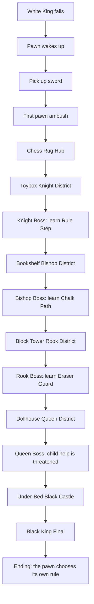

---

## 4. Bedroom World Drawing

This is the real world arrangement. The fantasy kingdom is layered on top.

```text
+--------------------------------------------------------------------+
| WINDOW / MOONLIGHT                     BOOKSHELF / BISHOP FORT     |
|                                      folded pages, diagonal lanes   |
|                                                                    |
| DESK / CHILD DRAWING AREA          BLOCK TOWER / ROOK RAMPARTS     |
| crayons, paper, fourth-wall help   rulers, blocks, straight lanes  |
|                                                                    |
| TOYBOX / KNIGHT YARD          CHESS RUG / MAIN BATTLEFIELD         |
| toys, tracks, L-shape danger   white camp, fallen king, hub         |
|                                                                    |
| DOLLHOUSE / QUEEN COURT                BED / UNDER-BED CASTLE      |
| mixed patterns, royal tricks           final rule engine, shadows  |
+--------------------------------------------------------------------+
```

### Playable Path Shape

```text
                     [Bookshelf Bishop]
                           |
                           v
 [Desk Child] <--> [Chess Rug Hub] <--> [Block Tower Rook]
       ^               |       \              |
       |               v        \             v
 [Toybox Knight] <- [Opening]    \----> [Dollhouse Queen]
                                                |
                                                v
                                      [Under-Bed Black King]
```

The hub is the chess rug. The bedroom objects are districts.

---

## 5. Core Combat Loop

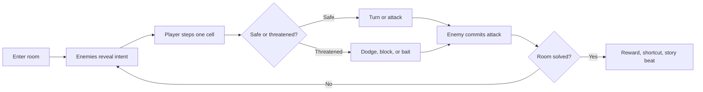

### Player Verbs

| Verb | Input Idea | Purpose |
|---|---|---|
| Step | WASD / stick | Move one cell in four directions |
| Hold step | hold direction | Keep moving at repeated grid rhythm |
| Turn | Shift + direction | Face without moving |
| Strike | Space / button | Basic weapon attack in facing direction |
| Skill | Q / trigger | Current toy weapon or rule-break skill |
| Interact | E / button | Talk, inspect, use object |
| Call child | R / shoulder | Spend Believe to use child intervention |
| Focus | hold button | Briefly strengthen telegraph visibility |

---

## 6. Start-To-End Game Structure

## Act 0 - The Board Dies

**Length:** 5-8 minutes  
**Location:** chess rug opening  
**Player state:** powerless pawn, no weapon at first

### Narrative

The white army loses before the player has control. The White King gives up or
is killed. Black pieces retreat toward the bedroom's darker regions, leaving
fallen pieces behind. The pawn wakes after everyone else is gone.

### Gameplay Goals

- Teach one-cell movement.
- Teach facing.
- Teach that the world is a chessboard on a bedroom floor.
- Establish loneliness and vulnerability.

### Rooms

```text
T1_WhiteKingsFall
T2_FallenSwordTile
```

### T1 Room Sketch

```text
+------------------------------+
| black retreat marks          |
| fallen white pieces          |
|                              |
|        dead White King       |
|                              |
| pawn wakes            exit > |
+------------------------------+
```

### T2 Room Sketch

```text
+------------------------------+
| torn paper / broken cells    |
|                              |
|       fallen sword           |
|          glow                |
| pawn start          exit >   |
+------------------------------+
```

### Unlock

| Unlock | Meaning |
|---|---|
| Wooden Sword | The pawn can now fight forward |

### Acceptance Target

The player should feel: "I am weak, but I can move."

---

## Act 1 - First Rule Break

**Length:** 10-15 minutes  
**Location:** chess rug battlefield  
**Player state:** sword, four-direction pawn movement

### Narrative

The pawn discovers that it can move backward, left, and right. That is already
forbidden. The child notices the pawn is different.

### Gameplay Goals

- Teach sword attack.
- Teach black pawn diagonal threats.
- Teach enemy telegraphs.
- Teach pickups and physical toy weapons.
- Establish the chess rug hub.

### Rooms

```text
T3_ChessRugBattlefield
H1_ChessRugHub
Optional: O1_CrayonCache
```

### T3 Combat Sketch

```text
+------------------------------+
|        black pawn            |
|   x                  x       |
|                              |
|        cover block           |
|                              |
| pawn start     sword lane >  |
+------------------------------+

x = telegraphed diagonal pawn threat
```

### H1 Hub Sketch

```text
+--------------------------------------+
|        to Bookshelf                  |
|             ^                        |
|             |                        |
| Toybox < chess rug hub > Block Tower |
|             |                        |
|             v                        |
|       Dollhouse locked               |
|       Under-bed sealed               |
+--------------------------------------+
```

### Unlock

| Unlock | Meaning |
|---|---|
| Pencil Spear | Two-cell straight skill, slower than sword |

### Acceptance Target

The player should feel: "I can read the board and win with timing."

---

## Act 2 - Toybox Knight District

**Length:** 15-20 minutes  
**Location:** toybox, tracks, toy fort, horse figures  
**Main enemy:** Knight  
**Main lesson:** delayed L-shaped threat

### Narrative

The toybox is imagined as a cavalry yard. Knights are proud because their rules
make them seem untouchable. The pawn learns that freedom beats tradition.

### Gameplay Goals

- Teach L-shaped attack markers.
- Teach baiting: stand where the Knight wants, then move.
- Teach that some enemies are vulnerable after commitment.
- Introduce the first true boss.

### District Flow

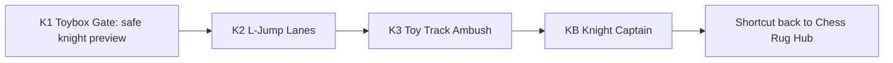

### Room Ideas

| Room | Purpose |
|---|---|
| Toybox Gate | One Knight target marker, low danger |
| L-Jump Lanes | Player crosses alternating L-threats |
| Toy Track Ambush | Pawns pressure while Knight marks landing cells |
| Knight Captain | Boss with leap, recovery, and toy-charge phase |

### Boss: Knight Captain

```text
Phase 1: marks one L-shaped landing cell
Phase 2: marks two possible cells, chooses one late
Phase 3: toybox shakes, blocks shift, recovery windows shrink
```

### Unlock

| Unlock | Meaning |
|---|---|
| Rule Step / Dodge | A fast two-cell emergency movement with cooldown |

### Acceptance Target

The player should feel: "The enemy is faster, but I can predict it."

---

## Act 3 - Bookshelf Bishop District

**Length:** 15-20 minutes  
**Location:** books, pages, bookmarks, paper bridges  
**Main enemy:** Bishop  
**Main lesson:** diagonal lanes and safe crossing

### Narrative

The bookshelf becomes a cathedral of rules. Bishops claim long diagonal truths.
The child first directly alters the battlefield with chalk or paper.

### Gameplay Goals

- Teach diagonal lane danger.
- Teach line-of-sight cover.
- Teach temporary child-built paths.
- Make the bedroom feel physical: books, pages, paper folds.

### District Flow

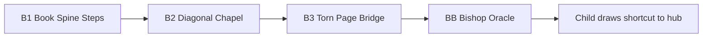

### Key Mechanic

The child can draw a chalk path or place a paper bridge over missing cells.

```text
gap gap gap
   |
child draws path
   v
walkable temporary cells
```

### Boss: Bishop Oracle

```text
Phase 1: simple diagonal beams
Phase 2: mirrored beams from paper reflectors
Phase 3: player must use drawn path to cross between safe islands
```

### Unlock

| Unlock | Meaning |
|---|---|
| Chalk Path | Child creates a temporary walkable route |

### Acceptance Target

The player should feel: "The room itself can be changed."

---

## Act 4 - Block Tower Rook District

**Length:** 15-20 minutes  
**Location:** toy blocks, ruler bridges, box ramparts  
**Main enemy:** Rook  
**Main lesson:** straight-line pressure and cover

### Narrative

The block tower is a fortress that believes in walls, rows, and columns. Rooks
do not hunt subtly. They declare a line, then crush everything in it.

### Gameplay Goals

- Teach row/column charge tells.
- Teach cover placement.
- Teach destructible blocks.
- Teach defense as an active verb.

### District Flow

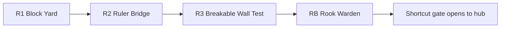

### Boss: Rook Warden

```text
Phase 1: charges one row or column
Phase 2: destroys weak blocks
Phase 3: player must use Eraser Guard or child block to survive
```

### Unlock

| Unlock | Meaning |
|---|---|
| Eraser Guard | Defensive/parry tool against straight-line attacks |

### Acceptance Target

The player should feel: "Standing still can be brave if I understand the line."

---

## Act 5 - Dollhouse Queen District

**Length:** 15-20 minutes  
**Location:** dollhouse, toy furniture, miniature court  
**Main enemy:** Queen  
**Main lesson:** mixed patterns and escalation

### Narrative

The dollhouse is beautiful, but everything inside is staged and controlled. The
Queen understands all previous rules and starts attacking the child's influence.

### Gameplay Goals

- Combine pawn, knight, bishop, and rook patterns.
- Test player mastery.
- Make child intervention less reliable.
- Create emotional tension before the final area.

### District Flow

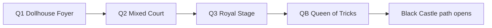

### Boss: Queen of Tricks

```text
Phase 1: diagonal plus straight lanes, not too many at once
Phase 2: summons armed pawns to steal space
Phase 3: disables one child intervention temporarily
Final opening: pawn must win with its own movement and facing
```

### Unlock

| Unlock | Meaning |
|---|---|
| Final Rule Break | One-time scripted power that opens the Black Castle |

### Acceptance Target

The player should feel: "I have learned enough to stand without constant help."

---

## Act 6 - Under-Bed Black Castle

**Length:** 20-25 minutes  
**Location:** under-bed shadow, chess box, rule engine  
**Main enemy:** Black King  
**Main lesson:** mastery and emotional payoff

### Narrative

The final castle is not a real castle. It is the darkest area under the bed,
where broken toys, the chess box, and forbidden items are hidden. The Black King
does not just command pieces. He commands the rule system.

### Gameplay Goals

- Revisit all enemy patterns.
- Remove safety gradually.
- Make the final boss feel like a rule battle, not only a health bar.
- Resolve the pawn/child relationship.

### Final Area Flow

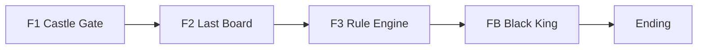

### Final Boss: Black King

```text
Phase 1: King moves one cell, short-range attacks
Phase 2: King commands old piece patterns from the room edges
Phase 3: King rewrites tiles, making some cells obey old chess rules
Phase 4: Child reaches in, but cannot finish the fight
Final strike: pawn chooses a new rule and attacks from freedom
```

### Final Boss Arena Sketch

```text
+--------------------------------------+
| rook lane      rule engine     bishop|
|                                      |
|    broken tiles      black king      |
|                                      |
| knight marks       safe chalk path   |
|                                      |
| pawn start      child hand shadow    |
+--------------------------------------+
```

### Ending

The pawn does not become a king. That would just join the old rule. Instead, the
child places the pawn back on the board as its own kind of piece.

Ending image:

```text
bedroom morning
chessboard quiet
child asleep or smiling
pawn standing outside the starting square
```

### Acceptance Target

The player should feel: "The pawn did not win by becoming powerful. It won by
becoming free."

---

## 7. Unlock And Progression Graph

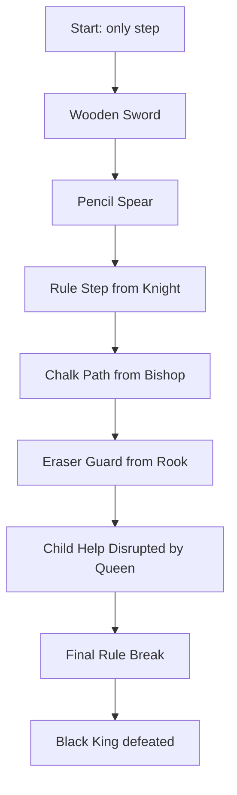

### Unlock Philosophy

| Unlock | Why It Exists | Where It Is Tested |
|---|---|---|
| Sword | Gives the pawn agency | First pawn ambush |
| Pencil Spear | Teaches range and commitment | Chess rug and Toybox |
| Rule Step | Lets player escape committed threats | Knight and Bishop rooms |
| Chalk Path | Lets room geometry change | Bookshelf and final castle |
| Eraser Guard | Adds defensive mastery | Rook and Queen rooms |
| Final Rule Break | Story climax, not spam skill | Black King final |

---

## 8. Enemy Escalation Graph

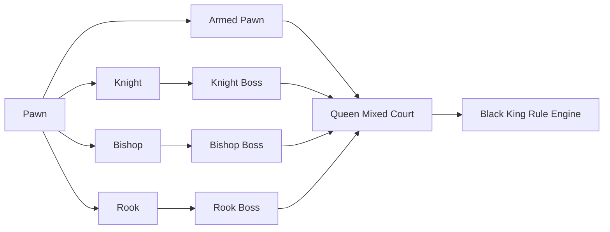

### Enemy Design Law

Enemies may move freely one cell at a time, but their unarmed attacks preserve
their chess identity.

Weapons replace chess attacks. They do not stack on top forever.

```text
Unarmed pawn = diagonal threat
Pawn with pencil = two-cell straight poke
Pawn with ruler = front plus forward diagonals
```

---

## 9. Room Group Formula

Every district should use this shape:

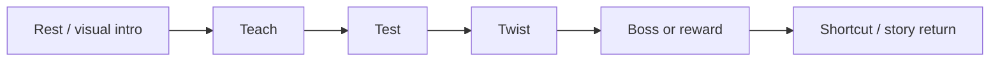

### Example: Knight District

```text
Rest: toybox entrance, no danger
Teach: one Knight marks one L cell
Test: Knight plus pawns
Twist: toy tracks block safe exits
Boss: Knight Captain
Reward: Rule Step
Shortcut: toybox lid path back to hub
```

---

## 10. Child Intervention Arc

The child should not feel like a menu spell. The child is a person outside the
board who becomes emotionally invested.

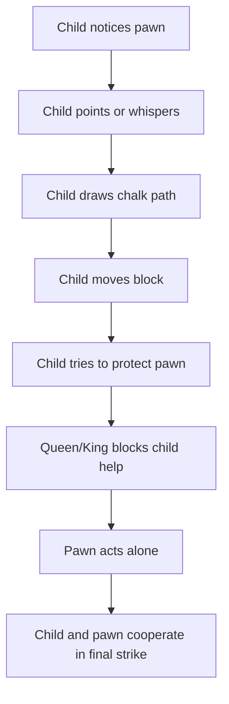

### Intervention Rules

| Rule | Reason |
|---|---|
| Child help changes the room, not enemy HP | Keeps pawn heroic |
| Help is limited by Believe meter | Prevents spam |
| Bosses can disrupt help temporarily | Creates drama |
| Final fight requires both pawn mastery and child trust | Pays off story |

---

## 11. Moment-To-Moment Feel Targets

| Feature | Target Feel |
|---|---|
| Step | Snappy, committed, rhythmic |
| Turn | Instant tactical correction |
| Sword | Fast, brave, close-range |
| Pencil | Safer reach, slower recovery |
| Dodge / Rule Step | Rare escape, not constant dash |
| Guard | Confident stand-your-ground moment |
| Enemy telegraph | Noticeable before deadly |
| Boss phase change | Visual and mechanical, not only more HP |

---

## 12. Parallel Production Plan

This design supports simultaneous production lanes.

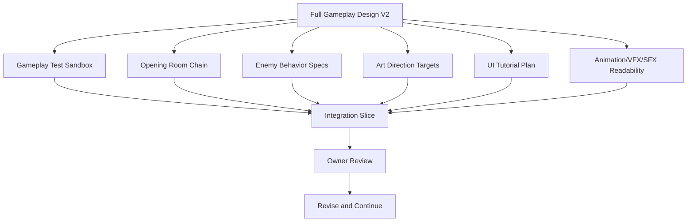

### What Can Start In Parallel After Owner Approval

| Lane | First Task |
|---|---|
| Gameplay | Build a sandbox for movement, sword, Pencil, dodge, guard |
| Rooms | Plan and build T1-T2-T3-H1 |
| Enemy | Write detailed pawn/knight/bishop/rook/queen/king behavior specs |
| Art | Define first-chain tile and prop palette |
| Animation | Define attack telegraph readability rules |
| UI | Define tutorial prompt style and Rule Book onboarding |
| Technical | Confirm scene template, exits, checkpoints, and test hooks |

---

## 13. Vertical Slice Recommendation

The first public-quality slice should not include every district.

Recommended slice:

```text
Opening death scene
Sword pickup
First pawn battle
Chess rug hub
Toybox Knight district
Knight Captain boss
Rule Step reward
Return to hub
Short teaser of child drawing a path
```

Target duration: 12-18 minutes.

This proves:

- core movement
- sword and one skill
- one normal enemy family
- one boss
- one district visual identity
- one child story beat
- room transitions
- editor-authored scene workflow

---

## 14. Risks And Fixes

| Risk | Why It Matters | Fix |
|---|---|---|
| Grid combat feels too stiff | Real-time action needs flow | Tune step recovery, buffering, enemy windups |
| Child help becomes too powerful | Pawn loses hero role | Help changes terrain, not enemy HP |
| Bosses become unreadable | Chess patterns can stack too much | Limit simultaneous threat shapes |
| Bedroom art hides gameplay | Beautiful props can clutter cells | Gameplay cells must stay readable first |
| Too many unlocks | Two-hour game can become messy | Keep only verbs that change decisions |
| Parallel production becomes chaos | Many lanes can drift apart | Weekly integration slice and owner review |

---

## 15. Current Owner Review Questions

Before implementation, approve or revise these:

1. Is the full journey order correct?
2. Should the first vertical slice end after the Knight boss?
3. Are these unlocks enough, or should one be cut?
4. Should child intervention be a resource meter, cooldown, or scripted-only?
5. Should the final ending keep the pawn as a pawn, or allow promotion?

Recommended answers:

```text
1. Yes, keep the journey order.
2. Yes, Knight boss is the right vertical-slice end.
3. Keep Sword, Pencil, Rule Step, Chalk Path, Eraser Guard, Final Rule Break.
4. Use a small Believe meter for normal rooms, scripted variants for bosses.
5. Keep the pawn as a pawn. Freedom is stronger than promotion.
```

---

## 16. Research Influence Notes

- *Guidus Zero*: real-time grid action can work if movement timing and enemy
  telegraphs are sharp.
- *Shogun Showdown*: small-board combat gains depth when facing, timing, and
  queued intent matter.
- *Hades II*: weapons should create different combat rhythms, not only stronger
  numbers.
- *Into the Breach*: visible enemy intent turns danger into solvable pressure.
- *Tactical Breach Wizards*: short tactical encounters can feel rich when each
  one has a clear purpose.
- *The Plucky Squire*: a childlike physical space can become the adventure world.
- *Shotgun King*: chess rules are strongest when transformed into a clear new
  fantasy.

