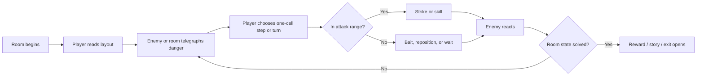

# GP.1 + LD.2 Spec - Core Gameplay Loop And First Room Chain

**Status:** approved by owner on 2026-09-30  
**Linked lanes:** Gameplay, Level And World Design, Narrative, Technical  
**Checklist gates:** `GP.1` and `LD.2`  
**Implementation allowed after approval:** no, this only approves the gameplay
loop and first room chain. Individual rooms still need their own production specs.

## Why These Two Gates Are Paired

`GP.1` and `LD.2` must be approved together because the first rooms are not just
places. They are the tutorial for the whole game.

The first chain must prove:

- the player fantasy,
- the grid movement,
- the attack rhythm,
- the child-room world identity,
- the opening emotional beat,
- and the first hub structure.

If the core loop and first rooms disagree, the whole game will feel confused.

---

## GP.1 - Core Gameplay Loop Spec

### Core Loop Statement

The repeated gameplay loop is:

```text
Enter a readable room.
Notice enemy or environmental intent.
Step one cell at a time.
Turn, strike, dodge, or wait.
Use a toy weapon or room object when needed.
Resolve the board-state problem.
Receive story, route, reward, or pressure toward the next room.
```

### Moment-To-Moment Loop



### Player Decision Questions

Every combat room should make the player ask:

```text
Where is danger going to happen?
Can I safely step there?
Should I face without moving?
Can I hit now, or do I need to bait first?
Is this a room problem, not just an enemy problem?
```

### Required Player Verbs For First Chain

The first chain only needs the smallest set:

| Verb | Required In First Chain? | First Use |
|---|---:|---|
| Step one cell | yes | `T1_WhiteKingsFall` |
| Hold direction to keep stepping | yes | `T1_WhiteKingsFall` |
| Turn without moving | yes | `T2_FallenSwordTile` |
| Strike | yes | `T2_FallenSwordTile` after sword pickup |
| Read enemy telegraph | yes | `T3_ChessRugBattlefield` |
| Use skill | no | introduced after first chain or optional in `H1` |
| Child intervention | no full system yet | foreshadow only in `H1` |

### First-Chain Gameplay Feeling

| Beat | Target Feeling |
|---|---|
| T1 | "I am small and alone, but I can move." |
| T2 | "I found a way to fight." |
| T3 | "I can read danger and win." |
| H1 | "This room is bigger than a battlefield; it is a world." |

### GP.1 Completion Requirements

`GP.1` can be marked `approved` only if the owner agrees that:

- one-cell real-time movement is still the main identity,
- turning without moving remains required,
- sword combat starts as one-cell facing attack,
- enemy danger must be telegraphed before damage,
- the first chain should not introduce every mechanic,
- child intervention should be foreshadowed before it becomes a system,
- and the first room chain is a correct tutorial for the full game.

### GP.1 Cannot Be Approved If

- the owner wants free analog movement instead of grid movement,
- the owner wants combat to start with multiple skills immediately,
- the owner wants the child intervention system active in room one,
- the owner does not like the "read board -> step -> strike" loop,
- or the first room chain does not feel like the right tutorial.

---

## LD.2 - First Room Chain Spec

The first playable chain is:

```text
T1_WhiteKingsFall -> T2_FallenSwordTile -> T3_ChessRugBattlefield -> H1_ChessRugHub
```

This is not a strict production order for all lanes. It is the first playable
route the player experiences.

## First Chain Flow Drawing

```text
+-------------------+     +-------------------+     +----------------------+
| T1 White King's   | --> | T2 Fallen Sword   | --> | T3 Chess Rug         |
| Fall              |     | Tile              |     | Battlefield          |
|                   |     |                   |     |                      |
| Move, wake, mood  |     | Pickup, turn, hit |     | First enemy reading  |
+-------------------+     +-------------------+     +----------+-----------+
                                                                  |
                                                                  v
                                                       +--------------------+
                                                       | H1 Chess Rug Hub   |
                                                       |                    |
                                                       | Routes, locks,     |
                                                       | child foreshadow   |
                                                       +--------------------+
```

## First Chain Bedroom Placement

```text
                   [Desk / child drawings - foreshadow]
                              ^
                              |
        [Toybox locked] <-- [H1 Chess Rug Hub] --> [Bookshelf locked]
                              ^
                              |
                     [T3 First Battlefield]
                              ^
                              |
                       [T2 Sword Tile]
                              ^
                              |
                    [T1 White King's Fall]
```

## Room Specs

### T1 - White King's Fall

**Purpose:** emotional opening and movement tutorial.

```text
+--------------------------------+
| black retreat marks            |
| fallen white pieces            |
|                                |
|        dead White King         |
|                                |
| pawn wakes              exit > |
+--------------------------------+
```

Required elements:

- fallen White King as focal point,
- fallen white pieces,
- signs of black army retreat,
- player pawn wake position,
- one clear exit,
- no major combat.

Gameplay:

- move one cell,
- hold direction,
- face direction naturally through movement,
- walk to exit.

Completion feeling:

> The player should feel quiet, small, and curious.

### T2 - Fallen Sword Tile

**Purpose:** weapon pickup and facing/attack tutorial.

```text
+--------------------------------+
| torn paper / broken board      |
|                                |
|        fallen sword            |
|          glow                  |
| pawn start              exit > |
+--------------------------------+
```

Required elements:

- visible toy sword or fallen enemy weapon,
- safe space to turn,
- safe object or dummy target to strike,
- one clear exit after pickup.

Gameplay:

- pick up sword,
- turn without moving,
- attack in facing direction,
- learn that attack is cell-based.

Completion feeling:

> The player should feel newly capable, not powerful yet.

### T3 - Chess Rug Battlefield

**Purpose:** first real combat.

```text
+--------------------------------+
| black pawn patrol              |
|     x              x           |
|                                |
|         low cover              |
|                                |
| pawn start              exit > |
+--------------------------------+

x = diagonal danger preview
```

Required elements:

- one or two black pawns,
- visible diagonal telegraph,
- enough empty cells to dodge,
- one piece of low cover or prop,
- exit opens after combat or is guarded by enemy placement.

Gameplay:

- read pawn threat,
- step out of danger,
- strike adjacent enemy,
- survive one real-time exchange.

Completion feeling:

> The player should feel clever, not lucky.

### H1 - Chess Rug Hub

**Purpose:** introduce the game world structure.

```text
+--------------------------------------+
|        to Bookshelf - locked         |
|                 ^                    |
|                 |                    |
| Toybox locked < + > Block Tower lock |
|                 |                    |
|                 v                    |
|        Dollhouse / Bed sealed        |
+--------------------------------------+
```

Required elements:

- clear central chess rug identity,
- visible but locked routes,
- route toward Toybox district as likely first expansion,
- visual foreshadow of child/desk intervention,
- safe enough for the player to breathe.

Gameplay:

- no heavy combat,
- inspect routes,
- understand locked future paths,
- maybe find optional crayon cache or story prompt.

Completion feeling:

> The player should feel the game opening into a bedroom world.

---

## First Chain Acceptance Matrix

| Requirement | GP.1 | LD.2 | Required Before Build? |
|---|---:|---:|---:|
| One-cell movement is main identity | yes | yes | yes |
| Opening rooms teach without overload | yes | yes | yes |
| Sword starts as simple facing attack | yes | yes | yes |
| First enemy teaches readable danger | yes | yes | yes |
| Hub introduces world routes | no | yes | yes |
| Child intervention is foreshadowed, not fully active | yes | yes | yes |
| First chain uses real bedroom chess-rug setting | yes | yes | yes |

---

## Dependencies With Other Lanes

These can move in parallel after this spec is approved:

| Lane | Parallel Next Task |
|---|---|
| Art Direction | define first-chain tile/prop/sprite targets |
| Technical | plan room transition and scene template |
| Narrative | draft opening beat and child foreshadow line |
| Animation | define wake, pickup, attack, pawn telegraph needs |
| VFX | define sword hit and pawn danger telegraph style |
| Audio | define wake, pickup, sword, warning sounds |
| QA | define first-chain playtest checklist |

---

## Owner Approval Questions

Please approve or revise these before any implementation:

1. Should the first playable chain stay `T1 -> T2 -> T3 -> H1`?
2. Should T1 have no real combat?
3. Should T2 teach turning and sword attack in safety?
4. Should T3 use black pawn diagonal telegraphs as the first enemy lesson?
5. Should H1 foreshadow the child intervention without unlocking it yet?

Recommended answers:

```text
1. Yes.
2. Yes.
3. Yes.
4. Yes.
5. Yes.
```

## Status

This spec was approved by the owner on 2026-09-30.

Approved gates:

- `GP.1`
- `LD.2`

Unlocked follow-up task specs:

```text
T1_WhiteKingsFall room production
Gameplay sandbox / first movement-combat test
First-chain art target
Room transition system
Opening story script
```
