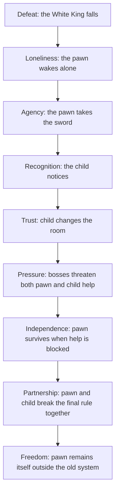

# NAR.1 Spec - Story Outline Approval

**Status:** approved by owner on 2026-09-30  
**Linked lane:** Narrative And Worldbuilding  
**Checklist gate:** `NAR.1`  
**Implementation allowed after approval:** no. This approves the story spine.
Dialogue, cutscenes, and room scripts still need separate specs.

## Story Spine

The story is:

> A white pawn survives a rigged chess war, is noticed by a child, and crosses
> the child's bedroom battlefield to defeat the Black King without becoming part
> of the old rule system.

The pawn does not win by becoming a queen or king. It wins by becoming free.

---

## Emotional Arc



---

## Act Story Beats

| Act | Location | Story Beat | Gameplay Meaning |
|---|---|---|---|
| Act 0 | Chess rug | White King dies, pawn wakes | Movement begins from loss |
| Act 1 | Chess rug hub | Pawn takes sword, child notices | Player gains basic agency |
| Act 2 | Toybox | Knight mocks pawn's weakness | Pawn proves prediction beats power |
| Act 3 | Bookshelf | Bishop defends written rules | Child first redraws the battlefield |
| Act 4 | Block Tower | Rook enforces walls and lines | Player learns defense and patience |
| Act 5 | Dollhouse | Queen controls the stage | Child help becomes vulnerable |
| Act 6 | Under-bed | King controls the rule engine | Pawn rejects the old system |
| Ending | Bedroom morning | The board is quiet | Pawn's freedom remains |

---

## Opening Story Requirements

The opening should communicate:

- the war is already lost,
- black pieces cheated with forbidden items,
- the White King is gone,
- the pawn was not chosen by rank,
- the child notices the pawn because it refuses to run or disappear,
- and the first player action is movement after defeat.

Opening should avoid long text. It should be mostly visual.

---

## Child Voice Rules

The child should feel:

```text
curious
gentle
imaginative
sometimes scared
not all-knowing
not a tutorial robot
```

The child should not constantly explain mechanics. Their help should be felt
through actions:

- a crayon line appears,
- a block is moved,
- paper is placed,
- a hand hesitates before helping,
- a small spoken line gives emotion, not a lecture.

---

## Boss Story Roles

| Boss | Story Role |
|---|---|
| Knight Captain | Pride in special movement and status |
| Bishop Oracle | Faith in written rules and diagonals |
| Rook Warden | Force, walls, and straight-line authority |
| Queen of Tricks | Control, performance, and manipulation |
| Black King | The rule system pretending to be a person |

---

## Ending Target

The ending should not say "the pawn promotes."

Recommended ending:

```text
Morning light enters the room.
The child looks at the chessboard.
The old pieces are back in place, but one square is empty.
The pawn stands just outside the board, near a blue crayon line.
The child smiles or quietly leaves it there.
```

Meaning:

> The pawn is still a pawn, but the board no longer owns it.

---

## Completion Requirements

`NAR.1` can be marked `approved` only if the owner agrees that:

- the pawn's arc is from powerless to free, not powerless to royal,
- the child is companion/helper, not god or narrator spam,
- the bedroom reality and imagined kingdom must both be present,
- each boss represents a rule or authority,
- and the ending should preserve the pawn's identity.

## Cannot Approve If

- the owner wants the pawn to promote into a queen/king as the main ending,
- the child should be only a player cursor with no emotional role,
- the story should be mostly comedy/parody,
- the black side should be purely evil without any rule-system theme,
- or the opening needs long exposition before play begins.

## Parallel Next Tasks After Approval

| Lane | Next Task |
|---|---|
| Narrative | `NAR.2` opening script |
| Level | story beats per first-chain room |
| UI | tutorial prompt tone |
| Audio | opening mood and child intervention sound direction |
| Animation | wakeup, fallen king, and first sword pickup story beats |
