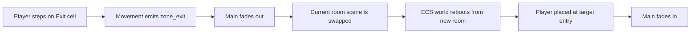

# TECH.2 Spec - Room Transition System

**Status:** approved by owner on 2026-09-30  
**Linked lane:** Technical Architecture  
**Checklist gate:** `TECH.2`  
**Implementation allowed after approval:** no. This approves the room travel
design. Implementation still needs a scoped task.

## Technical Goal

Room transitions must let the game grow from one room into a connected bedroom
world without turning every room into custom code.

The system should support:

```text
editable room scenes
visible entry markers
visible exit markers
world graph data
fade transition
player spawn at target entry
future locks, keys, shortcuts, and checkpoints
```

---

## Existing Foundation

The project already has useful foundations:

- `RoomEncounter` scene base with `zone_id` and `board_size`.
- `WorldGraph` resource for zone id to scene mapping.
- `main.gd` can boot a zone, swap zone nodes, and place the player at entries.
- ECS boot can size grids from rooms and bake gameplay data.
- Existing `ZoneEntryMarker` and `ZoneExitMarker` concepts exist in scripts.

This spec should refine that into a clean production workflow for the first
room chain.

---

## Desired Room Travel Model



---

## Authoring Model

Every production room should expose this structure clearly in Godot:

```text
RoomName
  RoomArt
    TileMap
    GridLines
    SetDressing
  Entries
    Entry_West
    Entry_East
  Exits
    Exit_East_To_T2
  Enemies
  Pickups
  Props
```

If the existing runtime needs flat children for now, the production rule still
stands: the scene tree must be understandable to the owner.

---

## First Chain Travel Graph

```text
T1_WhiteKingsFall
  east_exit -> T2_FallenSwordTile / west_entry

T2_FallenSwordTile
  west_exit -> T1_WhiteKingsFall / east_entry
  east_exit -> T3_ChessRugBattlefield / west_entry

T3_ChessRugBattlefield
  west_exit -> T2_FallenSwordTile / east_entry
  east_exit -> H1_ChessRugHub / south_entry

H1_ChessRugHub
  south_exit -> T3_ChessRugBattlefield / east_entry
  toybox_exit -> locked_or_future
  bookshelf_exit -> locked_or_future
  block_tower_exit -> locked_or_future
  dollhouse_exit -> locked_or_future
  under_bed_exit -> locked_or_future
```

---

## Data Requirements

Each exit must define:

| Field | Meaning |
|---|---|
| `target_zone` | Scene/world id to load |
| `target_entry` | Entry marker in target room |
| `requires_flag` | Optional progression flag |
| `locked_message` | Optional message if blocked |
| `one_way` | Optional shortcut behavior |

Each room must define:

| Field | Meaning |
|---|---|
| `zone_id` | Unique room id |
| `board_size` | Grid dimensions |
| `start_message` | First HUD/status prompt |
| `objective` | Optional clear condition |

---

## Completion Requirements

`TECH.2` can be marked `approved` only if the owner agrees that:

- rooms should be separate editable scenes,
- exits and entries should be visible in the editor,
- first-chain travel should support backtracking unless intentionally blocked,
- future locked paths should be represented visibly in `H1`,
- fade-swap is acceptable for room transitions,
- and the system should avoid per-room custom code.

## Cannot Approve If

- the owner wants one giant room/map instead of connected scenes,
- exits are allowed to exist only as hardcoded script data,
- the owner cannot inspect travel markers in Godot,
- or every new room would require custom transition code.

## Parallel Next Tasks After Approval

| Lane | Next Task |
|---|---|
| Technical | scoped implementation plan for first-chain transitions |
| Tools | update room authoring guide |
| QA | travel smoke test checklist |
| Level | per-room entry/exit placement |
| UI | locked-route prompt style |
