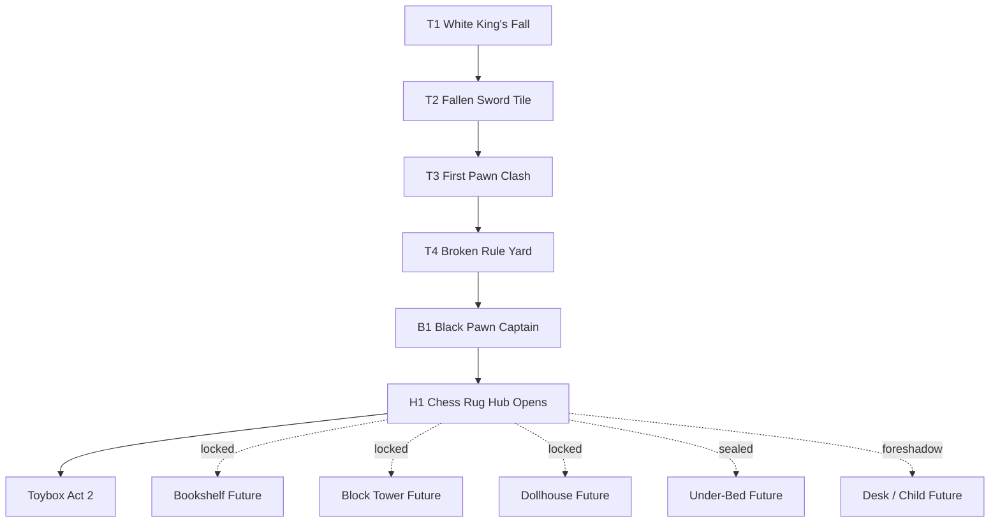

# Act 1 - Opening To First Boss Flow And Map

**Status:** approved for initial T1 build on 2026-09-30  
**Purpose:** define the first playable act before the Toybox district.  
**Implementation allowed:** no, this is a gameplay/world-flow plan.

This replaces the earlier idea that Act 1 should continue directly into Toybox.
Toybox should become the next act/district. Act 1 should be its own complete
tutorial chapter, like an action-adventure opening that teaches the core game
before the first real region opens.

Batch naming and act naming are related but not identical:

```text
Batch 1 = foundation approval gate
Act 1 = first playable chapter/tutorial arc
```

Act 1 uses the Batch 1 foundation and ends before Toybox:

```text
White King's fall -> sword -> first pawn combat -> chess-rug tutorial rooms
-> small first boss -> Chess Rug Hub opens -> Toybox becomes Act 2
```

---

## Act 1 Design Goal

Act 1 should make the player believe four things:

1. The White kingdom has already lost.
2. The pawn survives by learning movement, facing, timing, and courage.
3. The chess rug is a real place in a child's room, not a generic dungeon.
4. A small boss proves the player understands the rules before the world opens.

Target length:

```text
12-18 minutes for first-time players
8-12 minutes for vertical-slice pacing
```

Act 1 should end with a first boss that tests the tutorial, not a district boss.

Recommended first boss:

```text
Black Pawn Captain
```

Alternative names:

```text
Pawn Captain
The Rank Breaker
The Black Vanguard
```

Recommended reward:

```text
Chess Rug Hub access + first visible child foreshadow
```

No major skill should be awarded here. The reward is world opening, confidence,
and the right to leave the opening battlefield.

---

## Why Toybox Should Wait

Toybox is a district, not the tutorial.

Toybox introduces:

- a new material language,
- toy tracks,
- Knight L-shaped danger,
- future Rule Step reward,
- a boss with phase pressure.

That is too much immediately after learning sword and pawn telegraphs.

Act 1 should first answer:

```text
Can the player move, face, strike, dodge, read a simple telegraph,
and understand room exits?
```

Only after that should the game say:

```text
Now cross the room to the Toybox.
```

---

## Act 1 Shape Options

## Option A - Very Short Prologue

```text
T1 -> T2 -> T3 -> Small Boss -> Hub
```

Pros:

- fastest path to first boss,
- good for prototype.

Cons:

- may feel too thin,
- less room to establish the kid-room logic.

## Option B - Complete Tutorial Act

```text
T1 -> T2 -> T3 -> T4 -> Small Boss -> H1
```

Pros:

- gives each core action its own teach/test moment,
- feels like a real opening act,
- strong first boss setup.

Cons:

- one extra room to design.

## Option C - Hub Before Small Boss

```text
T1 -> T2 -> T3 -> H1 partial hub -> Small Boss -> H1 full hub
```

Pros:

- shows the wider room early.

Cons:

- risk of confusing the player before they are ready,
- weakens the boss as a gatekeeper.

## Recommended Shape

Use **Option B: Complete Tutorial Act**.

It gives the opening a real arc:

```text
wake -> arm -> survive -> prove mastery -> first boss -> world opens
```

This better matches an action-adventure/tutorial structure where the player
learns the language before the first major region.

---

## Real Kid-Room Logic

Act 1 happens entirely on or beside the chess rug.

The child-room logic:

```text
The child was playing a chess war on the bedroom rug.
The Black side cheated with toy weapons.
The battle scattered pieces across the rug.
The pawn wakes near the dead king.
The pawn follows the trail of broken pieces and black retreat marks.
Before the pawn can leave the rug, a Black Pawn Captain blocks the route.
Defeating that captain opens the rug hub and reveals the bedroom paths.
```

Physical arrangement:

```text
+------------------------------------------------------------------+
| WINDOW / MOONLIGHT                    BOOKSHELF                  |
|                                      future Act 3 route           |
|                                                                  |
| DESK / CHILD DRAWING AREA             BLOCK TOWER                |
| visible only as foreshadow            future Act 4 route          |
|                                                                  |
| TOYBOX / TRAIN TRACKS                 CHESS RUG                  |
| Act 2 route locked/teased             ACT 1 happens here          |
|                                                                  |
| DOLLHOUSE                             BED / UNDER-BED            |
| future Act 5 route                    final route                 |
+------------------------------------------------------------------+
```

Act 1 should not physically cross into the Toybox. It can show the Toybox from
the hub edge after the first boss.

---

## Act 1 World Map

Player-facing room graph:

```text
        [T1 White King's Fall]
                   |
                   v
        [T2 Fallen Sword Tile]
                   |
                   v
        [T3 First Pawn Clash]
                   |
                   v
        [T4 Broken Rule Yard]
                   |
                   v
        [B1 Black Pawn Captain]
                   |
                   v
        [H1 Chess Rug Hub Opens]
                   |
        +----------+----------+------------------+
        |          |          |                  |
        v          v          v                  v
   Toybox Act 2  Bookshelf   Block Tower     Desk Foreshadow
   visible/open  locked      locked          visible only
```

Physical-room overlay:

```text
                          NORTH WALL
        +------------------------------------------------+
        | Bookshelf locked       Desk / Child drawings   |
        | future route           blue crayon foreshadow  |
        |                                                |
WEST    | Toybox visible         Chess Rug Act 1         | EAST
WALL    | Act 2 entrance         fallen battlefield      | WALL
        |                                                |
        | Dollhouse locked       Bed / Under-bed sealed  |
        +------------------------------------------------+
                          SOUTH WALL
```

Player movement should feel like:

```text
wake inside the aftermath -> find a weapon -> survive the first soldiers ->
cross the broken battlefield -> defeat the captain guarding the rug edge ->
see the bedroom world open
```

---

## Act 1 Room List

## T1_WhiteKingsFall

Type:

```text
story / movement tutorial
```

Purpose:

- show the White King dead,
- teach one-cell movement,
- teach holding movement,
- establish quiet after defeat,
- point toward the sword trail.

Main player lesson:

```text
I can still move.
```

Kid-room logic:

```text
fallen chess pieces are scattered on the rug after the child imagined a war
```

Exit:

```text
east / rightward through black retreat marks
```

## T2_FallenSwordTile

Type:

```text
pickup / safe action tutorial
```

Purpose:

- give the first sword,
- teach facing,
- teach strike,
- let the player hit a harmless object or fallen black piece.

Main player lesson:

```text
I can fight if I face correctly.
```

Kid-room logic:

```text
a toy blade, pencil shard, or craft-stick weapon was dropped by a cheating
black piece
```

Exit:

```text
deeper into the rug battlefield
```

## T3_FirstPawnClash

Type:

```text
first real combat
```

Purpose:

- introduce Black Pawn Recruit,
- teach diagonal pawn attack telegraphs,
- teach that danger can be read before damage,
- make the sword feel necessary.

Main player lesson:

```text
Enemies have rules, and I can beat them by reading the board.
```

Enemy plan:

```text
one Black Pawn Recruit
```

Kid-room logic:

```text
the pawn fights near toppled chess pieces and scuffed rug squares
```

## T4_BrokenRuleYard

Type:

```text
second combat / rule-break tutorial
```

Purpose:

- prove that the player can move backward, left, and right,
- introduce simple cover or wall tiles,
- teach turn-without-moving under light pressure,
- hint that the pawn is already breaking normal chess rules.

Main player lesson:

```text
I am still a pawn, but I am no longer trapped by pawn movement.
```

Enemy plan:

```text
two weak Pawns, or one Pawn plus one armed Pawn with a slower readable attack
```

Room rule:

```text
the best solution should require repositioning, not only standing still and
pressing attack
```

Kid-room logic:

```text
broken chess squares, tape lines, a paper crease, or a knocked-over block create
small cover and force movement choices
```

## B1_BlackPawnCaptain

Type:

```text
first boss / tutorial exam
```

Purpose:

- test movement,
- test facing,
- test sword timing,
- test pawn telegraph reading,
- test simple room positioning,
- create a satisfying end to Act 1 before the world opens.

Main player lesson:

```text
I understand the game's first language.
```

Boss identity:

```text
a larger black pawn, carrying a stolen toy blade or broken royal banner,
blocking the edge of the chess rug
```

Boss combat question:

```text
Can I read diagonal danger, move to a safe cell, face correctly, and punish?
```

Arena logic:

```text
the edge of the chess rug, with the Toybox visible beyond but unreachable until
the captain falls
```

Boss phases:

| Phase | Behavior | Lesson |
|---|---|---|
| 1 | slow diagonal pawn telegraph | read before moving |
| 2 | short forward shove or sword swing | respect facing and range |
| 3 | calls one weak pawn or breaks a cover tile | stay calm under added pressure |

Reward:

```text
opens H1 Chess Rug Hub fully
reveals Toybox as Act 2
first clear child foreshadow: blue crayon mark, desk light, or small gasp
```

Important:

```text
Do not award Rule Step here.
Rule Step belongs to the Knight/Toybox act.
```

## H1_ChessRugHubOpens

Type:

```text
rest / orientation / act transition
```

Purpose:

- let the player breathe after the small boss,
- reveal the room routes,
- show Toybox as the next destination,
- show future locked routes,
- foreshadow the child more clearly.

Main player lesson:

```text
The chess rug was only the beginning.
```

Open route:

```text
Toybox / Act 2
```

Locked visible routes:

| Route | Lock Logic |
|---|---|
| Bookshelf | paper/book pile too high or diagonal page bridge missing |
| Block Tower | stacked block wall or ruler gate |
| Dollhouse | toy furniture barricade / royal seal |
| Under-Bed | blanket shadow / fear gate |
| Desk | child area visible but unreachable |

---

## Act 1 Flow Graph



---

## Gameplay Escalation

| Step | Room | New Idea | Pressure Level |
|---|---|---|---|
| 1 | T1 | move, hold move, read empty room | none |
| 2 | T2 | pickup, face, strike | safe |
| 3 | T3 | pawn telegraph and real damage | low |
| 4 | T4 | repositioning, turning, simple cover | medium |
| 5 | B1 | tutorial mastery boss | high for tutorial |
| 6 | H1 | world opens, routes and locks | safe |

Act 1 should avoid:

- Knight enemies,
- Toybox combat,
- Rule Step,
- child intervention as a full mechanic,
- multiple weapon switching,
- long dialogue,
- maze-like navigation.

---

## Story Flow

```text
T1: "The king is gone."
T2: "A weapon was left behind."
T3: "The pawn can fight."
T4: "The pawn is already breaking the movement rule."
B1: "The last black guard of the rug falls."
H1: "The bedroom world opens."
```

Child presence in Act 1:

- T1: no direct child voice.
- T2: no direct child voice, maybe a tiny room sound.
- T3: no direct child help.
- T4: subtle impossible room detail, like a crayon scratch crossing a tile.
- B1: after victory, the child notices the pawn for the first time.
- H1: desk/crayon/child-light foreshadow becomes visible.

The child should not solve Act 1. The child should become aware of the pawn at
the end of Act 1.

---

## Act 2 Setup

After Act 1, the next act should be:

```text
Act 2 - Toybox Knight District
```

Act 2 begins when the player chooses the Toybox route from H1.

Act 2 should cover:

```text
Toybox Entrance -> Toy Track Teach -> Toybox Test -> Knight Captain
-> Rule Step reward -> return to H1
```

The Knight Captain is no longer the first boss of the whole game. It is the
first district boss.

---

## Kid-Room Logic Rules

Every Act 1 room must answer:

```text
What part of the chess rug / nearby floor is this?
Why would it be next to the previous room?
What fantasy meaning does the child imagine onto it?
What gameplay rule does it teach?
```

Examples:

| Real Object | Fantasy Meaning | Gameplay Use |
|---|---|---|
| Chess rug | battlefield / fallen kingdom | grid, hub, first combat |
| Toy sword / pencil | forbidden weapon | first attack |
| Scuffed rug squares | war damage | route guidance |
| Paper crease | broken rule line | cover, forced movement |
| Knocked-over chess piece | battlefield obstacle | simple positioning |
| Blue crayon mark | child awareness | future fourth-wall help |

If a room cannot answer those four questions, it should not be in Act 1.

---

## Act 1 Acceptance Checklist

Act 1 can be approved only if:

- Toybox is not part of Act 1,
- the act ends with a small tutorial boss,
- the small boss tests movement, facing, sword, telegraph, and positioning,
- the chess rug clearly becomes the first act's whole play space,
- H1 opens after the first boss,
- Toybox becomes the next act/district,
- future routes are visible but blocked in understandable ways,
- the child is noticed/foreshadowed at the end rather than active from the start,
- and the full route can become separate editable Godot room scenes.

Cannot approve if:

- Toybox combat appears before the tutorial boss,
- the first boss requires Knight or district mechanics,
- the hub opens before the player proves the basics,
- Act 1 tries to teach too many systems,
- or the route feels like random fantasy rooms instead of a chess rug in a
  child's bedroom.

---

## Owner Review Questions

| Question | Recommended Answer |
|---|---|
| Should Toybox move to Act 2 instead of Act 1? | yes |
| Should Act 1 end with a small tutorial boss? | yes |
| Should the small boss be a Black Pawn Captain? | yes |
| Should Rule Step stay with the later Knight/Toybox act? | yes |
| Should H1 fully open after the tutorial boss? | yes |
| Should the child first clearly notice the pawn after the tutorial boss? | yes |
| Should this Act 1 flow replace the previous Toybox-in-Act-1 plan? | owner decision needed |

---

## Next Specs If Approved

If this Act 1 flow is approved, create these production specs in order:

```text
T2_FallenSwordTile production spec
T3_FirstPawnClash production spec
T4_BrokenRuleYard production spec
B1_BlackPawnCaptain production spec
H1_ChessRugHubOpens production spec
Act 2 Toybox overview spec
```

Do not build the rooms until their individual specs are approved.

---

## Approval State

Current state:

```text
approved_for_initial_build
```

Owner decision:

```text
approved to redesign and start building on 2026-09-30
```
